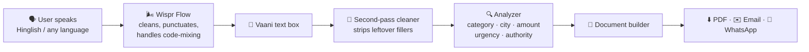

# 🎙️ Vaani

### Speak your problem. Get your paperwork done.

**A voice-first assistant that turns a spoken complaint, in Hindi, English or Hinglish, into a ready-to-submit complaint, RTI, consumer claim or legal draft. Built around [Wispr Flow](https://wisprflow.ai).**


---

## 💡 The problem

Millions of people in India know *exactly* what went wrong (a pothole that injured a neighbour, a laptop the seller won't refund, a landlord who keeps a deposit) but can't turn it into the formal letter an authority expects. Typing long formal text on a phone, in English, in the right format, is the real barrier.

**Vaani removes that barrier: you just talk.** It cleans what you said, works out what kind of problem it is, fills in the details, and gives you a document you can download, email or send.

---

## 🌬️ Wispr Flow: the heart of Vaani

> Vaani is a *voice* product. If the voice layer is bad, nothing downstream works. That is why Wispr Flow is the foundation, not an add-on.

### Why plain speech-to-text isn't enough

Real people don't speak in clean sentences. A real complaint sounds like this:

> *"Mujhe, um, Ahmedabad mein Naroda road pe sadak ki shikayat karni hai, uh, paani bhar raha hai aur log phisal rahe hain, jaldi repair chahiye"*

That one sentence has problems that break ordinary dictation tools:

| Challenge | What goes wrong with basic speech-to-text |
|---|---|
| **Hinglish code-mixing** (Hindi and English in one sentence) | Engines pick one language and mangle the other |
| **Filler words** (*um, uh, matlab, like*) | Land in the transcript and pollute the legal text |
| **No punctuation** | One unreadable run-on blob |
| **Names and places** (Naroda, Ahmedabad) | Misheard or mis-spelled |
| **Many Indian languages** | Support is patchy or missing |

### What Wispr Flow does about it

Wispr Flow is an AI dictation layer that works in any text field. It takes messy, natural speech and returns clean, punctuated text. For Vaani that gives us:

- ✅ **Filler words removed** before the text ever reaches our pipeline
- ✅ **Automatic punctuation and formatting**, so sentences are readable and ready to analyse
- ✅ **100+ languages**, covering the languages Vaani targets (Hindi, Gujarati, Marathi, Tamil, Kannada, Telugu, Malayalam, Punjabi, Assamese and more)
- ✅ **Mixed-language speech**, which is how people actually talk in India
- ✅ **Custom dictionary**, so local place names and legal terms (RTI, FIR, PIO, Naroda) are spelled correctly every time
- ✅ **Privacy Mode**, an important feature when people describe sensitive disputes

### How Wispr Flow fits into Vaani



Wispr Flow handles the **hard, human part** (understanding messy speech). Vaani handles the **domain part** (understanding what the speech *means* and turning it into the right legal paperwork). Each layer does what it's best at.

### Three ways Vaani listens

Vaani is designed so it works for everyone, whether or not you have special Wispr access, and it is always honest about which engine is in use.

| Mode | How it works | Needs | Label shown in the UI |
|---|---|---|---|
| **1. Wispr Flow desktop dictation** ⭐ *recommended* | Click Vaani's text box, press your Wispr hotkey, speak. Wispr types clean text straight into the box. | Free Wispr Flow account | Wispr Flow (user-side) |
| **2. Wispr Flow live API streaming** | Vaani's server mints a short-lived token; the browser streams 16 kHz audio over a WebSocket to Wispr and receives text live. | Wispr Flow API key (partner access) | `● Live with Wispr Flow` |
| **3. Browser fallback** | Chrome's built-in Web Speech API | Chrome | `Fallback: browser speech recognition (not Wispr Flow)` |

Mode 1 is the one that makes Vaani **fully usable on Wispr Flow's free plan, with no API key and no cost.**


### What Wispr Flow made possible

- **No custom speech engine to build.** We didn't train or host an ASR model for 12 languages. We got high-quality multilingual dictation by designing Vaani around Wispr Flow.
- **A genuinely better input experience.** Clean punctuated text arrives in the box, so the analyzer gets good input and the user sees a readable transcript, not a mess to fix.
- **Hinglish as a first-class language.** Code-mixed speech is the norm for many Indian users, and Wispr Flow handles it where simpler tools struggle.
- **Zero-friction onboarding.** Install Wispr, press a hotkey, talk. There's no new interface to learn.

---

## ✨ What makes Vaani unique

1. **Voice to finished document, not just voice to text.** Most dictation demos stop at a transcript. Vaani carries on: it classifies the problem, extracts the key facts, picks the right authority, and generates a formatted letter.
2. **Built for Indian reality.** Hinglish, Indian city detection, ₹ amounts, and Indian authorities (Municipal Commissioner, District Consumer Commission, PIO, Insurance Ombudsman, SHO).
3. **Two-layer cleaning.** Wispr Flow cleans at the speech layer; Vaani's own cleaner removes leftover fillers (*um, uh, matlab, like*) as a safety net, so the document is clean even in fallback mode.
4. **It knows what happens *after* the document.** Follow-up deadlines per category, the official portal to submit on, a checklist of documents to attach, and an auto-drafted follow-up letter (RTI follow-ups cite the First Appeal route under Section 19(1) of the RTI Act).
5. **Honest by design.** The UI always says which speech engine is active. It never claims "Wispr Flow" when it is actually using the browser fallback.
6. **Everything is editable.** Every extracted field and the final letter can be corrected before use. The AI assists; the person decides.

---

## 🚀 Features

**Voice and input**
- 🎙️ Speak via Wispr Flow dictation, optional live Wispr API streaming, or browser fallback
- 🌐 Language picker: Auto-detect, English, Hindi, Hinglish, Gujarati, Marathi, Tamil, Kannada, Konkani, Punjabi, Telugu, Assamese, Malayalam
- 🗣️ Voice commands, each also available as a button: *"open latest case"*, *"show consumer cases"*, *"mark submitted"*, *"download PDF"*, *"subject change karo: …"*, *"use invoice number"*
- ⌨️ Type instead of speak at any time

**Understanding**
- 🧹 Filler removal and clean transcript, shown side by side with the raw input
- 🗂️ Auto-categorisation: civic, consumer, RTI, rental, legal notice, police, insurance, custom
- 🔍 Extracts location, amount, party involved, urgency and desired outcome
- ❓ Asks a follow-up in Hinglish when something important is missing
- 📊 Confidence score

**Output and next steps**
- 📄 Formal letter with Subject, Facts, Timeline, Evidence, Requested Action
- ⬇️ Download PDF · ✉️ Email draft · 💬 WhatsApp summary · 📋 Copy
- 🔊 Read aloud, with the speech language picked from the script of the document
- 📅 Follow-up due date, official submission portal and attachment checklist
- ✉️ One-click follow-up letter
- 🧾 Evidence upload with in-browser **OCR** (Tesseract.js) that pulls out invoice number, date, vendor and amount

**Tracking and privacy**
- 📁 Case dashboard with status (Draft, Ready to Submit, Submitted, Follow-up Needed), filters and timelines
- ⏰ Overdue and upcoming follow-up reminders
- 🗑️ Delete any case, or all data, at any time

---

## 🖥️ Quick start

**Requirements:** Node.js 18+ and Chrome. A free [Wispr Flow](https://wisprflow.ai) account is recommended.

```bash
# 1. Clone
git clone https://github.com/<your-username>/vaani.git
cd vaani

# 2. Install
npm install

# 3. (Optional) enable live Wispr Flow API streaming
cp .env.example .env
# then add your key:  WISPR_API_KEY=fl-xxxxxxxx

# 4. Run API + web app together
npm run dev
```

Open **http://localhost:5173** in Chrome.

### Using Vaani with Wispr Flow (free plan)

1. Install Wispr Flow and set your hotkey. In settings, pick Hindi and/or English.
2. Open Vaani and go to the **Speak** tab.
3. Click the **"Or type your problem here…"** text box.
4. Hold your Wispr Flow hotkey and speak your complaint naturally, *um*s and all.
5. Release. Clean, punctuated text appears in the box. Click **Use typed text**.
6. Review the extracted fields and the generated letter, edit anything, then download or send.

> 💡 **Tip:** Add words like *Naroda*, *RTI*, *PIO* and *FIR* to your Wispr Flow custom dictionary for perfect spelling every time.

---

## 🔌 Live Wispr Flow API mode (optional)

If you have Wispr Flow API access, Vaani can stream audio directly:

1. The browser asks Vaani's server for a token: `POST /api/wispr/token`.
2. The server calls Wispr Flow with your key and returns a **short-lived token (about 5 minutes)**. **Your API key never reaches the browser.**
3. The browser captures microphone audio at 16 kHz, encodes it as WAV packets, and streams it to Wispr Flow over a WebSocket.
4. Text comes back live and fills the transcript. When you stop, Vaani commits the audio and builds the document.
5. If the token request or connection fails, Vaani falls back to browser speech recognition and **updates the label so the user is never misled**.

> Wispr Flow's API access is currently partner-only. Without a key, Vaani works fully through Mode 1 (desktop dictation) or Mode 3 (browser fallback).

---

## 🧱 Tech stack

| Layer | Tech |
|---|---|
| Voice | **Wispr Flow** (desktop dictation and optional API), Web Speech API fallback |
| Frontend | React 18, TypeScript, Vite, Tailwind CSS, Framer Motion |
| State | Zustand |
| Documents | jsPDF |
| OCR | Tesseract.js (runs in the browser) |
| Backend | Node.js, Express (token proxy and simple JSON case storage) |

### Project structure

```
vaani/
├── server/
│   └── index.js        # Express API: Wispr token proxy + case storage
├── src/
│   ├── App.tsx         # UI: Home, Speak, Dashboard, Cases
│   ├── lib.ts          # Analyzer, doc builder, speech engines, OCR, store
│   ├── index.css       # Glassmorphism theme
│   └── main.tsx
├── .env.example
└── package.json
```

---

## 🔒 Privacy

- Audio is used only to produce the document you ask for.
- Wispr Flow offers a **Privacy Mode**; enable it in the Wispr app for sensitive complaints.
- Cases are stored only in a local file (`server/data.json`) on the machine running Vaani.
- **Delete all my data** (Cases tab) wipes everything.

---

## ⚠️ Honest limitations

- Vaani produces **drafts, not legal advice.** Always review before submitting.
- Submission portals and procedures **vary by state**; the links are starting points. Please verify.
- Classification is **rule-based** (keywords and patterns), so unusual phrasing may land in "Custom document". You can change any field.
- The Wispr Flow free plan has a weekly word limit. Short spoken input is encouraged.
- Live Wispr Flow API streaming needs partner access.

---

## 🗺️ Roadmap

- [ ] Full Hindi / Gujarati UI (speech already supports them)
- [ ] LLM-assisted extraction for unusual or long complaints
- [ ] State-specific portal and template library
- [ ] Mobile-friendly PWA with Wispr Flow mobile dictation
- [ ] Multi-page letters with annexure auto-numbering

---

## 🙏 Acknowledgements

- **[Wispr Flow](https://wisprflow.ai)** for the voice layer that makes natural, messy, multilingual speech usable
- Tesseract.js, jsPDF, Framer Motion, Zustand and the open-source community

## 📄 License

Add your license here (for example MIT).

---


<div align="center">

**Built so that anyone who can speak can ask for justice, in their own words.** 🇮🇳

</div>
# Vaani
1. `npm install`
2. `cp .env.example .env`
3. `npm run dev` → open http://localhost:5173 (use Wispr Flow for mic + fallback speech)

<div align="center">
